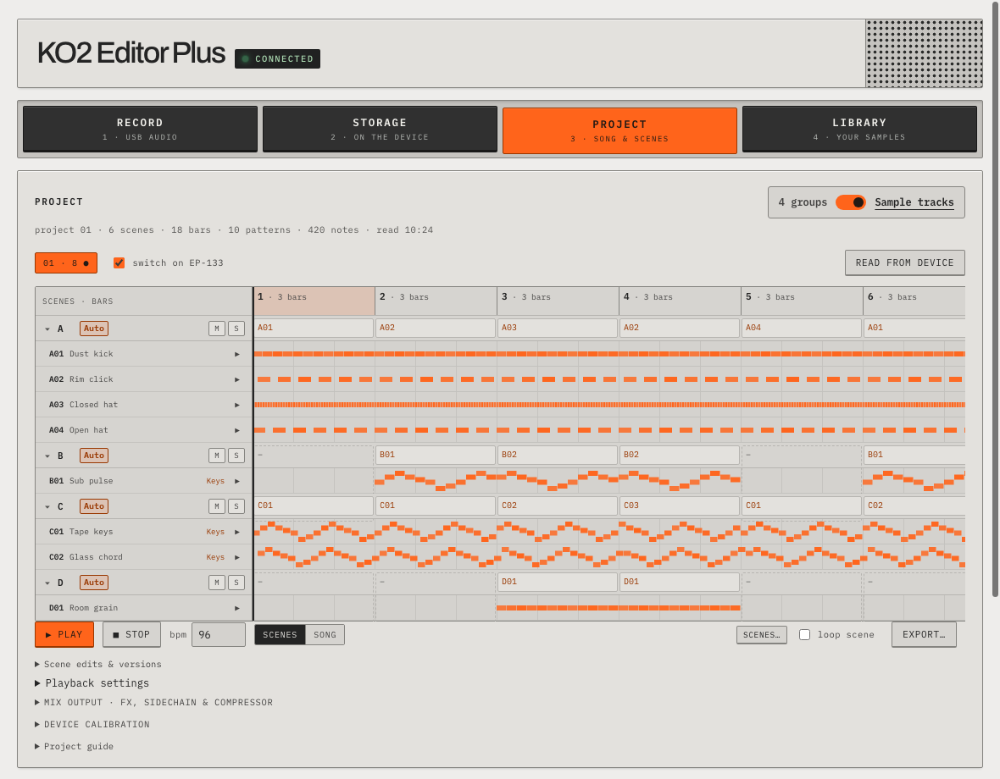
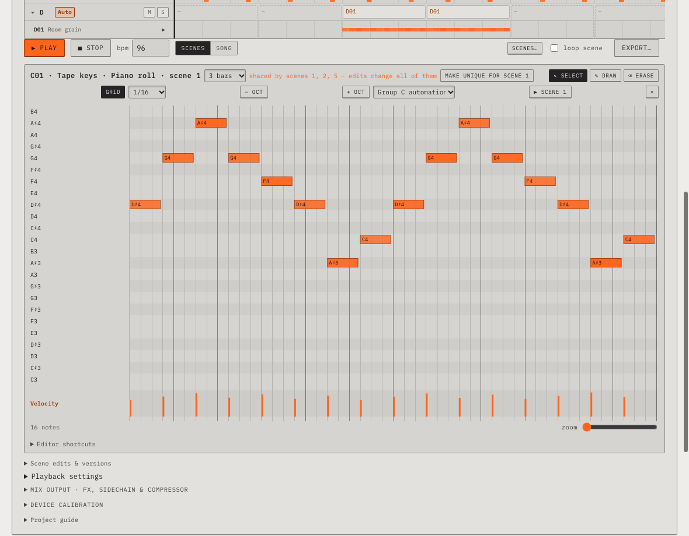

# KO2 Editor Plus

A macOS editor for the **teenage engineering EP–133 K.O. II**. Open a beat by scene, edit individual samples and Keys parts, then take aligned audio tracks and MIDI into Pro Tools or another DAW.

This is my first GitHub project. I built it because I like writing on the K.O. II and finishing a mix in Pro Tools. I wanted to keep the sounds, the timing and the small fader moves that made the beat work on the sampler.

## Get started on macOS

1. Download **KO2-Editor-Plus-0.1.0-macOS.zip** from the [first release](https://github.com/kintsugislop/ko2-editor-plus/releases/tag/v0.1.0). Extract the whole folder to a writable location on your Mac.
2. The first launch builds two small audio and MIDI helpers. You need Python 3.9 or later and Apple’s Command Line Tools. If the tools are missing, run `xcode-select --install` in Terminal and let the installation finish.
3. Connect your K.O. II over USB and double-click **KO2 Station.app** inside the extracted folder. Keep the launcher beside `src/`. The interface opens in your browser. A disconnected sampler still lets you use the local library and existing takes.
4. Leave Terminal open during the session. For recording, select the USB audio input in **Record** and allow microphone access for Terminal when macOS requests it. Press **Control-C** in Terminal to quit.

The launcher is unsigned. You can also start directly from Terminal by changing to the extracted folder and running `sh src/station`. Open [the local editor](http://127.0.0.1:8800/) if the browser tab was closed. Google Chrome was used for the release checks.

## Working with samples

Click any audio waveform to listen from that position. Hold and drag to move through the sound. In both trim editors, drag a handle to move a boundary.

## Library

Open **Library → Folders** and enter the paths to your local sample folders, one per line. If your Splice downloads are at `~/Splice/sounds`, the station suggests it automatically. For a custom Splice location or an external drive, enter the actual sounds folder. The station checks these folders and the local Splice catalogue at startup and every five minutes while running. **Save & rescan** starts a check immediately. Unplugged drives keep their index until they reconnect. Other sample folders work without Splice.

Each macOS account has its own local index, folder settings, tags and favourites under `data/library/<user>/`. Sample audio stays in its original location. For optional device measurements, install NumPy in `.venv/`. Similar-sound search also needs librosa. To enable both, run `python3 -m venv .venv` and then `.venv/bin/python -m pip install numpy librosa` from the project folder.

## Record

Use **Record → Takes → folder…** to choose a recording destination in Finder. Takes lists the WAV files in the selected folder. **Use default** switches back to `data/recordings/`. Switching folders leaves the files where they are.

While the input meter is active, **Keep last 30 s** saves the audio already heard into Takes. A newly opened input saves the time available. In a take’s **save…** editor, trim and fade a selection, then choose **send to pad…** and confirm the destination. The station creates a new sound slot and assigns it to that pad.

## Project and Pro Tools

The switch at the top of **Project** chooses **4 groups** or **Sample tracks**. In the group view, click a scene block to change its pattern assignments. In Sample tracks, every assigned pad has a lane, including pads with no recorded notes. Click a lane at a scene to edit that sample below the timeline. Keys and pitched parts open a piano roll. Drag notes to change timing or pitch, drag their right edge for duration and draw in the velocity lane.

**Auto** on a group reveals its recorded automation lanes. Click a lane in a scene to draw the group's pitch, filter or FX send. The editor's group automation menu also opens unused parameters. Playback settings, mix output and device calibration live below the timeline in Sample tracks. Changes to patterns stay in the local draft until you choose **Send to K.O.**.

Choose **Scenes** for scene-number order or **Song** for the programmed sequence. **Scenes…** lets you name a scene and set one to four plays per occurrence. The local preview and MIDI markers follow those settings. **Export… → Pad WAVs + MIDI** saves a new folder for each export. Drag the stereo WAVs onto separate audio tracks at the same session start. Import the MIDI for the tempo, scene markers, editable notes and controller data for each playing pad.

Audio is rendered at 48 kHz in 32-bit float. The Automation switch prints supported group fader movements into the individual WAVs. VEL and MOD fader movements are carried as MIDI CC data only. The MIDI uses paired controllers 20–31 and 52–63. Mapping them to plug-in parameters or DAW automation is a separate step. The group mix export also includes a reference with the modeled master chain.

Choose **Loop · exact bars** for an exact number of bars or **Song · keep tails** to keep decaying notes and effects. All rendered WAVs share one start and end. You can include a take as a hardware reference. That WAV keeps its original length and start, so align it by ear in the DAW.

**Scene edits & versions → Versions → Collect project** creates a folder with the edited project archive, every assigned sample (including silent pads), slot metadata and arrangement MIDI. The archive refers to samples by slot number. Keep the numbered WAVs with it when moving to another machine.

Both screenshots use a generated demo session.

## Folders

- `KO2 Station.app/` launches the station from Finder.
- `src/` contains the interface, server, audio and MIDI helper sources, bundled EP-133 calibration defaults and vendor libraries.
- `data/` is created locally. It holds recordings, exports, device snapshots, sample backups, calibration sessions and personal libraries.
- `docs/` contains screenshots and the release guide.
- `tests/` contains regression tests that run without a sampler.
- `temp/` is reserved for local development and recovery files.

Git excludes `data/`, `temp/`, and locally compiled helpers. To move an existing session, keep a separate backup of `data/`. Third-party license information for the MP3 encoder is in [src/vendor/lame.LICENSE.txt](src/vendor/lame.LICENSE.txt).

## Development

Run `python3 -m unittest discover -s tests -v` from the project folder. The optional archive check `python3 src/ep133write.py` verifies local project snapshots without connecting to the sampler.

This is an independent project. Teenage engineering makes the EP–133 K.O. II. MP3 encoding uses the unmodified [lamejs 1.2.1 source distribution](https://www.npmjs.com/package/lamejs/v/1.2.1), a port of [LAME](https://lame.sourceforge.io/).

[Инструкция по публикации и обновлению релиза](docs/RELEASING.ru.md)
